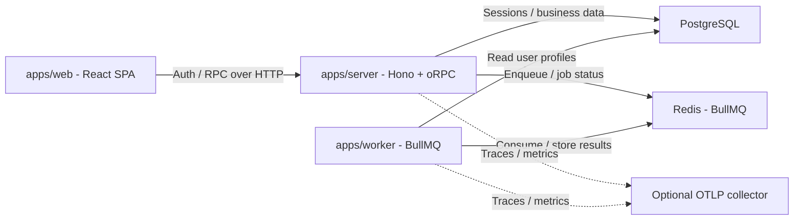

# Development guide

[English](development.md) · [简体中文](development.zh-CN.md) · [Project overview](../README.md)

This page covers runtime architecture and application wiring. Follow [extension examples](extension-examples.md) for changes, [operations](operations.md) for deployment and recovery, and [contributing](../CONTRIBUTING.md) for checks and releases.

## Architecture overview

Read the runtime view first, then follow a Todo request and a background job.
These diagrams describe the current implementation; the [extension examples](extension-examples.md)
show proposed additions. For allowed source imports, see the
[package dependency graph](extension-design.md#dependency-boundary-checks).

### Runtime topology

Solid arrows show communication with a process or store; dotted arrows show optional
telemetry export. Responses use the same connections and are omitted here.

<!-- mermaid:id=runtime-topology -->


The web app runs in the browser. In production, Nginx serves the SPA and proxies API
requests to Server; this proxy and TLS termination are omitted from the view.
Server and Worker each own their database connections and service instances.
Server produces jobs; Worker consumes them without calling the API. OTLP export is
optional and never a readiness dependency. See [runtime and logs](operations.md#runtime-and-logs)
for the separate database and queue readiness checks.

### Authenticated Todo request

The successful `todo.setCompleted` path crosses authentication, business rules and
an owner-scoped repository:

```mermaid
sequenceDiagram
  participant web as apps/web
  participant api as Hono / oRPC
  participant auth as Better Auth
  participant service as TodosService
  participant repo as Scoped Repository
  participant postgres as PostgreSQL
  web->>api: todo.setCompleted&#40;&#123; id, completed &#125;&#41;
  api->>auth: Resolve session from headers
  auth-->>api: session.user.id
  api->>service: setCompleted with session userId
  service->>repo: forUser&#40;userId&#41;.setCompleted&#40;&#123; id, completed &#125;&#41;
  repo->>postgres: UPDATE todos WHERE id = ... AND user_id = ...
  postgres-->>repo: Updated row
  repo-->>service: Owned Todo
  service-->>api: Operation result
  api-->>web: &#123; id, text, completed &#125;
```

<!-- mermaid:id=todo-request -->


API context resolves the session through Better Auth, which uses the injected
database. `protectedProcedure` rejects missing authentication with `UNAUTHORIZED`.
The router takes `userId` from the session, and `forUser(userId)` binds ownership to
SQL reads and writes. Missing or foreign Todos produce `NOT_FOUND`. New Todo operations
follow these boundaries; see the [Todo extension case](extension-examples.md#case-1-rename-a-todo).

### Profile-read background job

This shows a successful enqueue, processing and later status lookup. The API resolves
the session before both RPC calls; those authentication steps are omitted here.

```mermaid
sequenceDiagram
  participant web as apps/web
  participant api as API / ProfileReadClient
  participant redis as Redis / BullMQ
  participant worker as apps/worker
  participant postgres as PostgreSQL
  web->>api: users.enqueueProfileRead&#40;&#41;
  api->>redis: Enqueue profile with session userId and requestId
  redis-->>api: job.id
  api-->>web: &#123; id &#125;
  worker->>redis: Reserve job from user-profile queue
  redis-->>worker: &#123; userId, requestId &#125;
  worker->>postgres: Validate payload, then UsersService.getProfile&#40;userId&#41;
  postgres-->>worker: Profile or null
  worker->>redis: Mark completed and store result
  web->>api: users.getProfileReadJob&#40;&#123; id &#125;&#41;
  api->>redis: Read job and verify session ownership
  redis-->>api: Owned job state and result
  api-->>web: State and completed result
```

<!-- mermaid:id=profile-job -->


Worker validates the payload and uses its own `UsersService` instance. The queue is
`user-profile`, and the task name is `profile`. Status lookup verifies job ownership;
missing or foreign jobs produce `NOT_FOUND`. Clients can poll before completion;
`result` remains `null` until completed. A completed read can also return `null` if
the user no longer exists. Jobs may retry, so processors must tolerate repeated
execution. See the [new-job extension case](extension-examples.md#case-2-add-a-background-job)
for explicit consumer registration.

## Package extension guides

Choose the package that owns the change, then read its entry points, extension steps, and checks:

| Package | Responsibility |
| --- | --- |
| [API](../packages/api/README.md) | HTTP, authentication, and oRPC procedures |
| [Domain](../packages/domain/README.md) | Services, scoped repositories, and business-owned jobs |
| [DB](../packages/db/README.md) | Database factory, schema, migrations, and runtime grants |
| [Queue](../packages/queue/README.md) | Generic BullMQ connections and telemetry |
| [Observability](../packages/observability/README.md) | Logs, traces, metrics, and deadlines |
| [UI](../packages/ui/README.md) | Shared primitives and styles |

Follow [extension examples](extension-examples.md) for cross-package changes. The [extension contract](extension-design.md) defines named inputs, task exports, consumer lifecycle, and dependency rules. Shared TypeScript settings live in root `tsconfig.base.json`; each feature does not need its own package.

## Application extension entry points

| Application | Where to extend | What must stay coordinated |
| --- | --- | --- |
| `apps/web` | Routes in `src/routes`, app-specific components and `src/utils/orpc.ts` | Protected routes use `_auth`; user data query keys include identity. Keep loading, error and empty states; route types are generated by `pnpm check-types`. |
| `apps/server` | Dependencies in `src/services.ts`, process lifecycle in `src/runtime.ts` / `src/index.ts` | Wire new services into API `Services`; add readiness and cleanup for owned resources. Keep consumers in the Worker process. |
| `apps/worker` | Resources and `consumerDefinitions` in `src/runtime.ts`; process health/shutdown in `src/lifecycle.ts` | Add one explicit consumer definition to reuse group readiness, loop failure handling and concurrent drain. Extend shared resources only for new dependencies. |

Application configuration belongs in each app's `.env.schema`; regenerate types
with `pnpm env:generate`. Runtime configuration and package manifests are maintained
directly rather than through a scaffolding CLI.

## UI Customization

React web apps in this stack share shadcn/ui primitives through `packages/ui`.

- Change design tokens and global styles in `packages/ui/src/styles/theme.css` / `packages/ui/src/styles/globals.css`
- Update shared primitives in `packages/ui/src/components/*`
- Adjust shadcn aliases or style config in `packages/ui/components.json` and `apps/web/components.json`

### Add more shared components

Run this from the project root to add more primitives to the shared UI package:

```bash
npx shadcn@latest add accordion popover table -c packages/ui
```

Import shared components like this:

```tsx
import { Button } from "@full-stack-example/ui/components/button";
```

### Add app-specific blocks

If you want to add app-specific blocks instead of shared primitives, run the shadcn CLI from `apps/web`.

## Environment Configuration

Each app owns its environment schema in `.env.schema`. Varlock generates `src/env.ts` during installation; run `pnpm run env:generate` after changing a schema. Commit schemas, and keep secrets in ignored env files or your deployment platform.

Import the generated `ENV` accessor in application code. Shared database and auth packages receive configuration or initialized clients from the application. See [Varlock's monorepo guide](https://varlock.dev/guides/monorepos/).

The Vite integration and Node server bootstrap load Varlock. Node deployments include Varlock and its dependencies alongside the app schema.

Run standalone Node tools that use Varlock from the owning app directory so they load that app's schema and env files. `env:generate` only generates TypeScript files; it does not initialize environment values in a subsequent command.

`pnpm env:init` creates development values for Web/API on 3001/3000 and PostgreSQL/Redis on 5432/6379, generates a random auth secret, and prints only filenames. Existing files are preserved; edit local values or supply process overrides. The default local database and Compose project are named `full-stack-example`. When renaming the project, update `DATABASE_URL` in existing server/worker value files; migrate data before changing Compose project or volume names.

`REDIS_URL` defaults to `redis://localhost:6379`; containers use `redis://redis:6379`, with Redis persistence and `noeviction`. Worker uses the same database and Redis as API, with its own `.env.schema` and no Better Auth secret.

## Better Auth Schema Generation

After changing auth plugins or schema options, run `pnpm run auth:generate` from the project root. The script runs the Better Auth CLI through `varlock run` from the owning app directory, loading the auth instance from `src/auth-schema.ts`. Review the schema changes, then use your ORM's migration workflow to apply them.

## Application composition

Applications use explicit factories and dependency injection. Processes own creation and cleanup; importing modules starts neither connections nor consumption.

Server callers await `createServices`. If assembly fails, it attempts to close every
acquired producer and database concurrently within `SERVER_SHUTDOWN_TIMEOUT_MS`
(30 seconds when omitted), logs cleanup failures or timeout, and rethrows the
original assembly error. A timed-out close may still finish later. Successful
shutdown remains idempotent and closes the producer before the database. Each
resource factory remains responsible for allocations it has not returned.

| Entry point | Responsibility |
| --- | --- |
| `apps/server/src/index.ts` | Serve Hono over HTTP and own API process shutdown |
| `apps/server/src/services.ts` | Create the database, Better Auth, queue client, and business services |
| `apps/worker/src/runtime.ts` | Create independent database/services and explicitly register and start consumers |
| `packages/api/src/create-api.ts` | Accept initialized dependencies and return the Hono application |
| `packages/api/src/context.ts` | Resolve sessions and provide business services to procedures |

Hono handles routing, CORS, request logs, and HTTP errors; oRPC Fetch adapters own business procedures, and Better Auth uses its Fetch handler. Server listens through `@hono/node-server` on Node.js. CORS covers auth, RPC, API reference, health, and preflight requests.

`createApi` mounts `/api/auth/*`, `/rpc`, `/api-reference`, and health routes. Liveness checks and unmatched URLs do not resolve sessions. Better Auth receives an explicit database and config; its URL/environment cookie defaults support local HTTP and production HTTPS. Auth schema generation initializes only database/auth.

Todo and users procedures require authentication and derive user IDs from the session. Business logic is called through `context.services`; API and Worker reuse service factories with independent instances per process.

Authenticated clients can call:

```ts
const profile = await client.users.me();
const job = await client.users.enqueueProfileRead();
const status = await client.users.getProfileReadJob({ id: job.id });
```

The example job returns only `id`, `name`, and `emailVerified`. Inspect only your own jobs: `result` is `null` before completion or if the user no longer exists; missing or foreign jobs return `NOT_FOUND`. Completed jobs are retained for up to one hour / 1,000 entries; failed jobs for one day / 1,000 entries. Cleanup happens when later jobs finish. Poll with a deadline.

To add a Service, expose its factory in domain, create it in `createServices`, add its type to API `Services`, and register its router. Job contracts and Worker factories belong to the owning domain package; register consumers explicitly in `apps/worker/src/runtime.ts`. See [extension examples](extension-examples.md) for the steps and [Worker runtime limits](operations.md#worker-runtime-limits) for startup, retries, and shutdown budgets.

## Complete module example

Use `packages/domain/src/todos` as the CRUD reference. Its factory receives a database;
`createServices` wires it into `context.services`. Routers validate inputs and
map a missing or foreign resource to the same `NOT_FOUND` response. Never accept
an owner ID from the browser. `repository.ts` owns SQL, field projections and the
user scope: `createTodosRepository({ db }).forUser(session.user.id)` returns operations
that always filter by that owner and assign it on insert. It returns resolved data,
never a mutable query builder. Scopes are immutable closures, so a shared repository
cannot switch another request's user. Keep pagination and business decisions in
`service.ts`, along with the existing operation spans and metrics. Repository
factories accept a database or transaction and never create or close connections.
Use a scoped repository where ownership rules repeat; simple modules do not need
an extra repository layer or a generic base class. This is an application-level
boundary; using the raw database directly can bypass it.

`todo.list({ cursor?, limit? })` returns `{ items, nextCursor }`, ordered by
ID descending. Limit defaults to 20 and cannot exceed 100; the cursor is the
last ID from the preceding page. Text is trimmed and limited to 1–500 characters.
Create/toggle return `{ id, text, completed }`; delete returns `{ id }`.
The old `todo.getAll` interface is removed. Add an index and a reviewed migration
alongside new query patterns, and test them against PostgreSQL.

Protected pages belong under the `_auth` layout. Query keys include the current
user ID. The session boundary cancels and clears queries and invalidates router
context when identity changes; delayed RPC responses from an older identity are
rejected. A `UNAUTHORIZED` response clears private state and returns to login with
a validated relative return path. Mutations have a shared error notification,
which a page-specific `onError` may override. Never retry writes automatically.

[Frontend routes and Shadcn Admin integration](frontend.md)

[Roles and page access](access-control.md)
