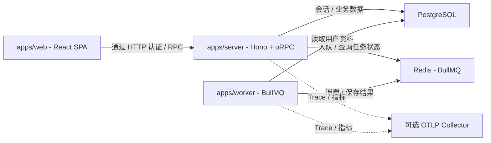

# 开发指南

[English](development.md) · [简体中文](development.zh-CN.md) · [项目说明](../README.zh-CN.md)

本页说明运行架构与应用接线。具体改动见[扩展示例](extension-examples.zh-CN.md)，部署与恢复见[运维指南](operations.zh-CN.md)，检查与发布见[贡献指南](../CONTRIBUTING.zh-CN.md)。

## 架构导览

先看运行架构，再跟随一次 Todo 请求和一次后台任务。以下图示描述当前实现；[扩展示例](extension-examples.zh-CN.md)介绍待实现的新增功能。源码允许的 import 方向见[包依赖图](extension-design.zh-CN.md#依赖边界检查)。

### 运行架构

实线箭头表示与进程或存储通信，虚线箭头表示可选的 telemetry 导出。响应沿原连接返回，图中省略。

<!-- mermaid:id=runtime-topology -->


前端运行在浏览器中。生产环境由 Nginx 提供 SPA 并将 API 请求代理到 Server；图中省略代理和 TLS 终止层。Server 和 Worker 各自拥有数据库连接和服务实例。Server 负责生产任务，Worker 独立消费，无需调用 API。OTLP 导出可选，不能成为就绪依赖。数据库与队列分别如何检查就绪，见[运行时与日志](operations.zh-CN.md#运行时与日志)。

### 已认证的 Todo 请求

`todo.setCompleted` 成功路径依次经过认证、业务规则和限制用户归属的 Repository：

```mermaid
sequenceDiagram
  participant web as apps/web
  participant api as Hono / oRPC
  participant auth as Better Auth
  participant service as TodosService
  participant repo as Scoped Repository
  participant postgres as PostgreSQL
  web->>api: todo.setCompleted&#40;&#123; id, completed &#125;&#41;
  api->>auth: 从请求头解析会话
  auth-->>api: session.user.id
  api->>service: setCompleted，使用会话 userId
  service->>repo: forUser&#40;userId&#41;.setCompleted&#40;&#123; id, completed &#125;&#41;
  repo->>postgres: UPDATE todos WHERE id = ... AND user_id = ...
  postgres-->>repo: 更新后的行
  repo-->>service: 当前用户的 Todo
  service-->>api: 操作结果
  api-->>web: &#123; id, text, completed &#125;
```

<!-- mermaid:id=todo-request -->


API context 通过 Better Auth 解析 session，Better Auth 使用注入的数据库。`protectedProcedure` 对未认证请求返回 `UNAUTHORIZED`。路由从 session 获取 `userId`，`forUser(userId)` 将用户归属绑定到 SQL 读写。不存在和属于其他用户的 Todo 均返回 `NOT_FOUND`。新增 Todo 操作也遵循这些边界，见 [Todo 扩展示例](extension-examples.zh-CN.md#案例一重命名-todo)。

### 读取用户资料的后台任务

图中展示一次成功入队、处理，以及稍后的状态查询。两次 RPC 调用前，API 均会解析 session；图中省略这部分认证步骤。

```mermaid
sequenceDiagram
  participant web as apps/web
  participant api as API / ProfileReadClient
  participant redis as Redis / BullMQ
  participant worker as apps/worker
  participant postgres as PostgreSQL
  web->>api: users.enqueueProfileRead&#40;&#41;
  api->>redis: 入队 profile，携带会话 userId 和 requestId
  redis-->>api: job.id
  api-->>web: &#123; id &#125;
  worker->>redis: 从 user-profile 队列领取任务
  redis-->>worker: &#123; userId, requestId &#125;
  worker->>postgres: 校验载荷，再调用 UsersService.getProfile&#40;userId&#41;
  postgres-->>worker: 用户资料或 null
  worker->>redis: 标记完成并保存结果
  web->>api: users.getProfileReadJob&#40;&#123; id &#125;&#41;
  api->>redis: 读取任务并校验会话用户归属
  redis-->>api: 当前用户的任务状态和结果
  api-->>web: 状态和已完成结果
```

<!-- mermaid:id=profile-job -->


Worker 校验任务载荷，并使用自己的 `UsersService` 实例。队列名为 `user-profile`，任务名为 `profile`。状态查询检查任务归属，不存在或属于其他用户的任务返回 `NOT_FOUND`。客户端可在完成前轮询，此时 `result` 为 `null`；用户已不存在时，成功完成的读取也可能返回 `null`。任务可能重试，处理函数需要能承受重复执行。新增消费者的显式注册步骤，见[新任务扩展示例](extension-examples.zh-CN.md#案例二新增后台任务)。

## 包扩展指引

先确定改动归属，再阅读对应包的代码入口、扩展步骤和验证方法：

| 包 | 职责 |
| --- | --- |
| [API](../packages/api/README.zh-CN.md) | HTTP、认证和 oRPC 过程 |
| [Business](../packages/business/README.zh-CN.md) | 业务服务、Scoped Repository 和业务任务 |
| [DB](../packages/db/README.zh-CN.md) | 数据库工厂、schema、迁移和运行角色授权 |
| [Queue](../packages/queue/README.zh-CN.md) | 通用 BullMQ 连接和 telemetry |
| [Observability](../packages/observability/README.zh-CN.md) | 日志、trace、指标和 deadline |
| [UI](../packages/ui/README.zh-CN.md) | 共享基础组件和样式 |

跨包改动跟随[扩展示例](extension-examples.zh-CN.md)；具名参数、任务入口、消费者生命周期和依赖规则见[扩展约定](extension-design.zh-CN.md)。共享 TypeScript 配置位于根目录 `tsconfig.base.json`，不要求每个业务特性都新增一个包。

## 应用扩展入口

| 应用 | 修改入口 | 需要同步处理 |
| --- | --- | --- |
| `apps/web` | `src/routes` 路由、应用专用组件和 `src/utils/orpc.ts` | 受保护页面放在 `_auth` 下，用户数据 query key 包含身份；保留加载、错误和空状态。`pnpm check-types` 会生成路由类型。 |
| `apps/server` | `src/services.ts` 组装依赖，`src/runtime.ts` / `src/index.ts` 管理进程 | 将新服务接入 API 的 `Services` 类型；为进程拥有的资源补齐就绪检查和关闭逻辑。消费者仍由 Worker 进程启动。 |
| `apps/worker` | `src/runtime.ts` 的资源组装和 `consumerDefinitions` 注册表；`src/lifecycle.ts` 的进程健康／退出 | 新消费者添加一个显式定义，复用全组就绪、运行故障和并行 drain；有新依赖时才扩展共享资源。 |

应用配置写入各自的 `.env.schema`，通过 `pnpm env:generate` 重新生成类型。当前直接维护运行配置和包清单，不通过脚手架 CLI 修改技术栈。

## UI 定制

本项目的 React 前端通过 `packages/ui` 共享 shadcn/ui 基础组件。

- 在 `packages/ui/src/styles/globals.css` 修改设计变量和全局样式。
- 在 `packages/ui/src/components/*` 修改共享基础组件。
- 在 `packages/ui/components.json` 和 `apps/web/components.json` 调整 shadcn 别名或样式配置。

### 添加共享组件

在项目根目录执行以下命令，将更多基础组件加入共享 UI 包：

```bash
npx shadcn@latest add accordion dialog popover sheet table -c packages/ui
```

按以下方式导入共享组件：

```tsx
import { Button } from "@full-stack-example/ui/components/button";
```

### 添加应用专用区块

如果要添加仅供当前应用使用的区块，而不是共享基础组件，请在 `apps/web` 中运行 shadcn CLI。

## 环境配置

各应用通过自己的 `.env.schema` 定义环境配置。安装依赖时，Varlock 会生成 `src/env.ts`；修改配置定义后，运行 `pnpm run env:generate`。提交配置定义文件，将密钥保存在被 Git 忽略的环境文件中，或交由部署平台管理。

应用代码通过生成的 `ENV` 对象读取配置。共享数据库和认证包由应用传入配置或已初始化的客户端。详情见 [Varlock monorepo 指南](https://varlock.dev/guides/monorepos/)。

Vite 集成和 Node 服务启动入口会加载 Varlock。Node 部署产物包含应用配置定义、Varlock 及其依赖。

使用 Varlock 的独立 Node 工具应从所属应用的目录运行，以加载该应用的配置定义和环境文件。`env:generate` 只生成 TypeScript 文件，不会为后续命令初始化环境变量值。

`pnpm env:init` 创建开发配置：Web/API 使用 3001/3000，PostgreSQL/Redis 使用 5432/6379，并生成随机认证密钥，只输出文件名。已有文件保留，可修改本地值或通过进程环境覆盖。默认本地数据库和 Compose 项目名均为 `full-stack-example`；项目改名时需同步已有 server/worker 配置中的 `DATABASE_URL`，切换 Compose 项目或卷名之前需迁移数据。

`REDIS_URL` 默认使用 `redis://localhost:6379`；容器使用 `redis://redis:6379`，Redis 开启持久化和 `noeviction`。Worker 使用与 API 相同的数据库和 Redis，通过自己的 `.env.schema` 配置，不需要 Better Auth 密钥。

## 生成 Better Auth 表结构

修改认证插件或表结构相关选项后，在项目根目录运行 `pnpm run auth:generate`。该脚本会进入所属应用目录，通过 `varlock run` 执行 Better Auth CLI，并从 `src/auth-schema.ts` 加载认证实例。审查生成的表结构变更，再通过 ORM 的迁移流程应用到数据库。

## 应用组装

应用使用显式工厂和依赖注入。依赖的创建和关闭由进程负责，仅导入模块不会建立连接或启动消费。

| 入口 | 负责内容 |
| --- | --- |
| `apps/server/src/index.ts` | 启动 Hono HTTP 服务，管理 API 进程退出 |
| `apps/server/src/services.ts` | 创建数据库、Better Auth、队列 client 和业务服务 |
| `apps/worker/src/runtime.ts` | 创建独立数据库与服务，显式注册并启动消费者 |
| `packages/api/src/create-api.ts` | 接收已初始化的依赖，返回 Hono 应用 |
| `packages/api/src/context.ts` | 解析 session，向 procedure 提供业务服务 |

Hono 处理路由、CORS、请求日志和 HTTP 错误，oRPC Fetch adapter 处理业务过程，Better Auth 使用 Fetch handler。Server 通过 `@hono/node-server` 监听；运行时是 Node.js。CORS 覆盖认证、RPC、接口文档、健康检查和 preflight。

`createApi` 挂载 `/api/auth/*`、`/rpc`、`/api-reference` 和健康路由。存活检查与未匹配 URL 不解析 session。Better Auth 接收显式数据库和配置，Cookie 安全使用其 URL／环境默认规则，本地 HTTP 可用，生产使用 HTTPS。认证 schema 生成入口只初始化数据库和认证。

Todo 和 users 过程要求登录，从 session 取得用户 ID。业务逻辑通过 `context.services` 调用；同一服务工厂可供 API 和 Worker 复用，各进程使用独立实例。

登录后的客户端可调用：

```ts
const profile = await client.users.me();
const job = await client.users.enqueueProfileRead();
const status = await client.users.getProfileReadJob({ id: job.id });
```

示例任务只返回 `id`、`name`、`emailVerified`。查询自己的任务，未完成或用户已不存在时 `result` 为 `null`；不存在或属于其他用户时返回 `NOT_FOUND`。完成结果最多保留一小时／1,000 条，失败任务最多保留一天／1,000 条；清理由后续任务完成触发。轮询需设置 deadline。

新增 Service 时，在 business 暴露工厂，在 `createServices` 创建，将服务类型加入 API `Services` 并注册 router。后台任务的契约和 Worker 工厂归所属业务包，消费者在 `apps/worker/src/runtime.ts` 显式注册。具体步骤见[扩展示例](extension-examples.zh-CN.md)，启动、重试和关闭预算见[Worker 运行限制](operations.zh-CN.md#worker-运行限制)。

## 完整模块示例

以 `packages/business/src/todos` 作为增删改查模块的参考。其工厂接收数据库，`createServices` 将服务注入 `context.services`。路由负责校验输入，对不存在和属于其他用户的资源统一返回 `NOT_FOUND`。不要接受浏览器传入的资源所属用户 ID。

`repository.ts` 负责 SQL、字段投影和用户范围：`createTodosRepository({ db }).forUser(session.user.id)` 返回的操作始终按该用户过滤，创建时也固定填入该用户 ID。方法返回执行结果，不暴露可修改的查询构造器。每个 scope 使用独立闭包，共享 repository 不存储可变的当前用户。`service.ts` 保留分页、业务判断和原有操作级 span、指标。Repository 工厂可接收数据库或事务，不负责创建和关闭连接。归属规则重复时再引入 scoped repository，简单模块无需额外层次，也不引入通用基类。这是应用层约束，直接使用原始数据库仍然可以绕过。

`todo.list({ cursor?, limit? })` 返回 `{ items, nextCursor }`，按 ID 降序排列。每页默认 20 条，最多 100 条；游标为上一页最后一条记录的 ID。文本会去除首尾空白，长度限制为 1–500 个字符。创建和切换完成状态操作返回 `{ id, text, completed }`，删除操作返回 `{ id }`。旧的 `todo.getAll` 接口已移除。引入新的查询方式时，应同时增加相应索引和经过审查的迁移，并使用 PostgreSQL 验证。

需要登录的页面放在 `_auth` 布局下，查询键包含当前用户 ID。身份发生变化时，会话边界组件会取消并清除查询缓存，使路由上下文失效；来自旧身份的延迟 RPC 响应会被拒绝。收到 `UNAUTHORIZED` 响应后，清除私有状态并跳转到登录页，返回地址仅接受经过校验的相对路径。写操作统一显示错误通知，页面可通过自己的 `onError` 覆盖。不要自动重试写操作。
