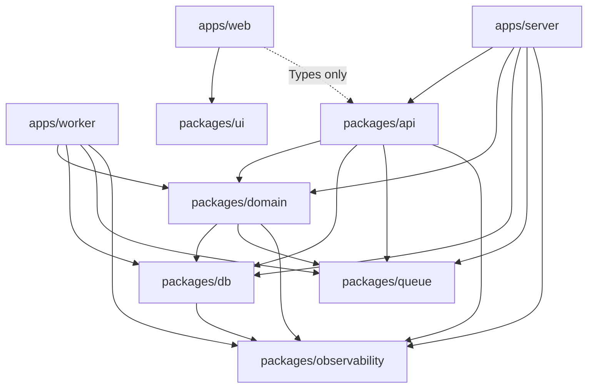

# Extension contract

[English](extension-design.md) · [简体中文](extension-design.zh-CN.md) · [Development guide](development.md) · [Project overview](../README.md)

This document describes the current business interfaces,
consumer runtime and CI boundaries. Package READMEs provide focused extension steps.
The [extension examples](extension-examples.md) apply these contracts to proposed
Todo and background-job additions, without claiming those additions exist today.

## Goals and scope

Extend regular features through business implementation, application injection
and API routing. Extend background work through business-owned task implementation
and explicit consumer registration. Lifecycle algorithms are shared across consumers.

Keep the six shared packages. Standardize comparable factories and business calls
while retaining database, UI and infrastructure-specific interfaces. Changes to public
HTTP payloads/results, compatibility aliases, queue/task names, retry/retention policies,
or database schema require a separate compatibility and migration assessment.

## Ownership and composition

| Location | Owns | Extension work |
| --- | --- | --- |
| [domain](../packages/domain/README.md) | Services, scoped repositories, task contract/client/processor/Worker factories | Feature code and required public subpaths |
| [API context](../packages/api/src/context.ts) and routers | Service capabilities, identity, input validation and RPC errors | Inject operations and mount routers |
| [server services](../apps/server/src/services.ts) | Database and task client creation/ownership | Wire capabilities, readiness and cleanup |
| [Worker runtime](../apps/worker/src/runtime.ts) | Consumer protocol, explicit definitions, composition and lifecycle | One definition per new consumer; resource composition changes only for new dependencies |
| [Worker entry](../apps/worker/src/index.ts), [lifecycle](../apps/worker/src/lifecycle.ts) and heartbeat | Signals, fatal failures, process exit, heartbeat removal and final deadline | One process-level exit path |
| db/queue/observability/ui | Their infrastructure or shared capabilities | Changes only when the capability itself changes |

The consumer protocol belongs to the application runtime. Business factories keep
returning native BullMQ Workers that structurally satisfy it, without importing
application types. Queue remains generic connection/telemetry infrastructure. Read-only monitoring
is assembled in the server: the profile producer exposes its existing Queue,
and the server registry maps a stable key plus summary projectors onto that
instance. API wraps `@bull-board/api` `BullMQAdapter` behind `queues` oRPC
procedures protected by `pageProcedure("queues")`. Bull Board's HTTP app and UI
are not mounted. A new queue appears in the UI only after that server registry
lists it.

## Factories and business operations

Business Service, Repository and task factories take one named dependency object.
Infrastructure interfaces such as `createDb(config, options)` and `createLogger(...)`
can retain their existing conventions.

Usage:

```ts
const service = createTodosService({ db });
const repository = createTodosRepository({ db: tx });
const owned = repository.forUser(userId);

await service.list({ userId, cursor, limit });
await service.create({ userId, text });
await service.setCompleted({ userId, id, completed });
await service.delete({ userId, id });

await owned.list({ cursor, limit });
await owned.setCompleted({ id, completed });
await owned.delete(id);

await profileJobs.enqueueProfileRead({ userId, requestId });
await profileJobs.getProfileReadJob({ userId, jobId });
```

- Multiple business fields use an object. Single identifiers can stay primitive:
  `forUser(userId)`, `getProfile(userId)` and scoped `delete(id)`.
- Repositories accept the query-method shape of a database or transaction,
  without requiring a pool or `close()`. Use cases own transaction boundaries.
- Owners come from authenticated sessions or validated task contexts. Inserts
  assign ownership explicitly rather than spreading arbitrary input into SQL.
- Scopes are independent closures; business methods return data, not builders.
- Services retain decisions, pagination and `observeOperation`. Small queries
  can remain in services without introducing a repository.
- Resource owners retain `close()`; API context only exposes business methods.

## Task names and public entry points

Include the task name in public subpaths while keeping producer/consumer roles
separate. Physical files stay under `users/jobs/profile-read.*.ts`.

| Removed export | Current export |
| --- | --- |
| `domain/users/jobs/contract` | `domain/users/jobs/profile-read/contract` |
| `domain/users/jobs/producer` | `domain/users/jobs/profile-read/producer` |
| `domain/users/jobs/worker` | `domain/users/jobs/profile-read/worker` |
| `domain/users/jobs/status` | Internal producer helper |

All paths above use the `@full-stack-example/` prefix. Factories share the task prefix:
`createProfileReadClient`, `createProfileReadProcessor`, `createProfileReadWorker`.
The client owns enqueue and owner-scoped status lookup; derive types from factories.

Business is a private workspace package: callers have migrated and the old internal
exports are removed. HTTP compatibility aliases remain. Redis queue `user-profile`
and task `profile` are unchanged; pending jobs use the same contract.

## Explicit consumer registration

These types live in Worker runtime. `WorkerServices` lists concrete process
services; `WorkerResources` owns that collection, shared readiness and cleanup.

```ts
type Consumer = {
  waitUntilReady(): Promise<unknown>;
  run(): Promise<void>;
  isRunning(): boolean;
  getBackend(): {
    readonly client: Promise<{
      status: string;
      get(key: string): Promise<string | null>;
    }>;
  };
  close(force?: boolean): Promise<void>;
};

type ConsumerDefinition = {
  name: string;
  concurrency?: number;
  create(options: {
    redisUrl: string;
    services: WorkerServices;
    concurrency: number;
    logger: Logger;
  }): Consumer;
};

const consumerDefinitions = [
  {
    name: USER_PROFILE_QUEUE,
    create: ({ redisUrl, services, concurrency, logger }) =>
      createProfileReadWorker({
        redisUrl,
        usersService: services.usersService,
        concurrency,
        logger,
      }),
  },
] satisfies readonly ConsumerDefinition[];
```

`WorkerFactories.consumerDefinitions` replaces the single `createWorker` injection
point. Each synchronous factory returns a handle with error listeners installed.
Business Worker factories hardcode `autorun: false` and stop exposing that switch
to callers; runtime alone starts execution loops, while registrations only wire
dependencies. Factories own rollback before returning a handle; runtime immediately
records every returned handle for cleanup.

Validate configuration, a nonempty registry, stable unique names, and default/
override integer concurrency of 1–100 before resource allocation. Existing
`WORKER_CONCURRENCY` remains the per-consumer default; total process concurrency
is the sum across consumers. Review pool/memory capacity when adding consumers.
Use stable queue names from business contracts, never instance or user IDs.

## Multiple-consumer lifecycle

Track internal `starting`, `running`, `closing`, `closed` and `failed` states to
handle concurrent events consistently.

| Phase | Shared behavior |
| --- | --- |
| Shared resources | Create database/services and check database readiness; do not create consumers on failure |
| Consumer creation | Call factories sequentially, recording each returned handle; a later constructor failure still closes earlier handles |
| Readiness barrier | Wait for all `waitUntilReady()` calls concurrently; do not run any consumer before all pass |
| Execution | Start every loop and immediately observe each Promise before returning runtime |
| Group readiness | Only while running: check the database once, then all consumers' running state, Redis state and bounded read probes concurrently; delete the heartbeat on any failure |
| Graceful close | Enter closing synchronously and stop heartbeat; close consumers concurrently, then close shared database after all drains complete, then flush telemetry |
| Startup rollback | Force-close every created consumer, collecting cleanup results with allSettled, then release shared resources; retain startup and cleanup failures |
| Failed exit | A failed or timed-out graceful close enters forced nonzero process termination; never report successful draining |

Preserve phase-based startup timeouts: one `WORKER_STARTUP_TIMEOUT_MS` for the
database check and one shared deadline for all consumer readiness, independent of
consumer count. Bound startup rollback with existing `WORKER_SHUTDOWN_TIMEOUT_MS`.
Shutdown uses one process budget with the entry's hard-exit timer, not a full
budget per consumer.

Startup uses `startWorker({ config, factories, logger, signal })`, with
optional test factories, logger and AbortSignal. The entry owns an AbortController:
on exit signals, cancel startup progression before starting idempotent shutdown.
Runtime checks cancellation at waits and creation/run boundaries. Cancellation
interrupts readiness waits and rolls back owned resources; it does not claim to
cancel driver I/O, and all pending Promises remain observed. Once running,
`runtime.close()` owns shutdown. Expected startup cancellation during shutdown is
not a new business failure; cleanup failure still produces a nonzero exit.

BullMQ's [`close()` waits for active jobs and has no built-in timeout](https://docs.bullmq.io/guide/workers/graceful-shutdown).
The normal path must drain every consumer before releasing their shared database.
After close failure/timeout, active jobs may be interrupted: attempt connection
aborts and terminate unsuccessfully, relying on retryable/idempotent work rather
than treating disconnection as completion.

`close()` caches and returns the same Promise. One failed close must not skip
other close attempts. Never close the shared database in the background before
all normal drains finish; if stopping cannot be confirmed, let forced process
termination release resources. On cleanup errors, the entry must guarantee
eventual nonzero termination, not merely set exitCode and clear its hard timer
while connections remain open.

`runtime.done` aggregates execution loops:

- A rejection or unexpected normal completion while running is fatal, identifies
  its stable consumer name, and triggers whole-process shutdown from the entry.
- A normal job failure follows BullMQ retry policy and is not a loop failure.
- Normal completion while closing is expected; rejections remain shutdown errors.
- Observe each loop and the aggregate immediately, before the entry subscribes.
  Collect every loop result during shutdown so later failures are not lost.

Keep the existing heartbeat interface: a shared 2-second group probe, every
5 seconds, with 15-second freshness. One unhealthy consumer invalidates group
health. Fatal loop failures exit for deployment-managed restart; there is no
per-consumer automatic restart inside the process.

## Observability conventions

- Preserve metric names, normalized HTTP routes and native BullMQ propagation;
  avoid duplicate spans during structural changes.
- Lifecycle logs carry stable consumer/phase fields. Job logs retain job ID,
  request ID, attempt and outcome.
- Any new consumer-state metrics use static registration names and bounded states,
  never request/user/job IDs as labels.
- Detach queue observers and await observations before closing their clients;
  shut down the SDK after business resources. Exporters remain outside readiness.
- Runtime enriches failures with identity; the process entry owns the final
  exception log. Retain cleanup errors without logging the same exception at
  every layer.

## Dependency boundary checks

`scripts/check-boundaries.mjs` (`pnpm check:boundaries`) runs in CI and uses the
existing TypeScript parser without new dependencies. It checks production src
against this internal dependency policy:

Arrows below point from an importer to an allowed internal dependency. This is the
CI allowlist, so an edge does not mean that import is currently used or that an HTTP
call occurs. The dotted web-to-API edge permits only the router's type contract;
Worker has no API dependency.

<!-- mermaid:id=package-dependencies -->


| Source | Allowed internal dependencies |
| --- | --- |
| apps/web | ui and type-only API client contracts |
| apps/server | api, domain, db, queue, observability |
| apps/worker | domain, db, queue, observability |
| api | domain, db, queue, observability |
| domain | db, queue, observability |
| db | observability |
| queue/observability/ui | No other internal packages |

Inspect static imports/exports, literal dynamic imports and type imports. Resolve
aliases and cross-directory relative paths, enforce public exports, and detect
package cycles. Exclude fixtures/integration tests that legitimately cross app
boundaries. Validate current production code before enabling CI, and cover
allowed/forbidden edges, type-only imports, aliases and relative-path bypasses.

## Implementation and verification

- Business parameters, task names and exports have migrated together with all callers.
- Runtime owns the consumer list; [lifecycle](../apps/worker/src/lifecycle.ts) owns
  cancellation, heartbeat, telemetry flushing and final process termination.
- [Runtime tests](../apps/worker/tests/runtime.test.ts) use controlled long-lived
  loops for one/two consumers. [Process tests](../apps/worker/tests/lifecycle.test.ts)
  cover startup cancellation, initial heartbeat and a real child hard exit.
- [Integration tests](../apps/server/tests/integration/application.test.ts) use
  dedicated queues to verify two native Workers can finish database work while
  draining. Factory tests explicitly start and observe the paused Worker.
- [Boundary tests](../scripts/check-boundaries.test.mjs) cover allowed/forbidden
  edges, type imports, exports, aliases, path bypasses and cycles.

Production still registers only the profile consumer. The second consumer exists
only in tests. Run the acceptance checks below when changing these contracts;
real-service and production validation run in CI, not in the offline test suite.

## Acceptance scenarios

1. Invalid configuration, empty definitions or duplicate names allocate nothing.
2. Database readiness gates construction; all Redis readiness gates every run.
3. A later constructor failure, failed readiness or a stalled connection attempts
   cleanup for every returned handle and fails startup within its budget.
4. A loop rejection/unexpected completion rejects done, invalidates health and
   starts closing other consumers.
5. Concurrent loop failures retain the first failure's identity and collect later
   errors without unhandled rejections.
6. Job retries do not stop the process; enqueue, ownership and traces still work.
7. Signals during startup, initial heartbeat or execution leave no healthy file;
   repeated close calls return the same Promise.
8. Two consumers drain concurrently; database stays available until both finish
   and closes exactly once afterward.
9. Failed close never skips other closes; hanging drain exceeds one global budget
   and exits nonzero without claiming graceful completion.
10. Rejections during close remain failures; expected normal loop completion does
    not become a new execution failure.
11. Collector outages leave operations/readiness functional; consumer metric
    cardinality grows only with static definitions.
12. Use dedicated PostgreSQL/Redis for integration/E2E, verify isolated production
    packages and production Compose, and retain the BullMQ race regression checks.


A new tool also needs a stable access page key/path, a route and display metadata in the web catalog. Authorize its API with `pageProcedure`, derive ownership from the session, and keep domain ownership checks independent of the UI. Register any worker consumer explicitly; the catalog does not wire runtime resources.
