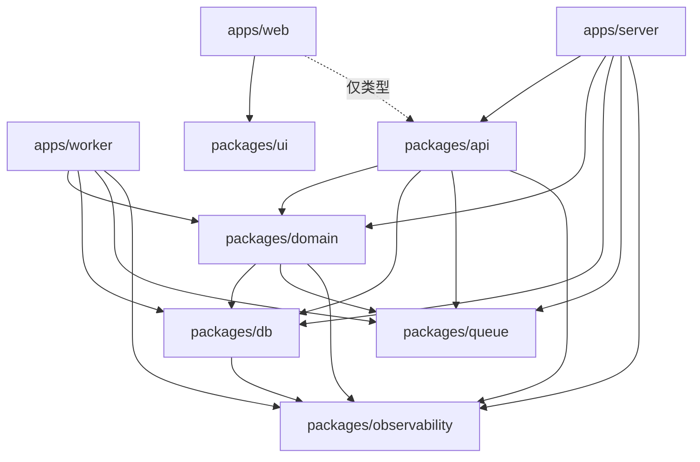

# 扩展约定

[English](extension-design.md) · [简体中文](extension-design.zh-CN.md) · [开发指南](development.zh-CN.md) · [项目说明](../README.zh-CN.md)

本文定义业务接口、消费者运行时和 CI 依赖边界；各包 README 提供对应的扩展步骤。

[扩展示例](extension-examples.zh-CN.md)将这些约定应用到待实现的 Todo 和后台任务扩展，不表示当前已提供这些新功能。

## 目标与范围

新增普通业务按“业务实现 → 应用注入 → API 路由”扩展；新增后台任务按“业务任务实现 → 显式注册消费者”扩展。生命周期逻辑不随消费者数量重复编写。

保持六个共享包。统一同类工厂和业务操作的调用习惯，保留数据库、UI 和基础设施各自的接口。变更公共 HTTP 接口、兼容别名、队列名、任务名、重试／保留策略或数据库结构时，应单独评估兼容性与迁移方案。

## 职责与接线位置

| 位置 | 负责内容 | 扩展时修改 |
| --- | --- | --- |
| [domain](../packages/domain/README.zh-CN.md) | 服务、Scoped Repository、任务契约／client／processor／Worker 工厂 | 新增业务代码和必要的公共子路径 |
| [API context](../packages/api/src/context.ts) 与路由 | 服务能力类型、身份、输入校验、RPC 错误 | 注入业务方法并挂载路由 |
| [server services](../apps/server/src/services.ts) | 创建并拥有数据库和任务 client | 新能力接线、就绪检查和资源关闭 |
| [Worker runtime](../apps/worker/src/runtime.ts) | 消费者协议、显式注册列表、组装和生命周期 | 新消费者增加一个定义；新业务依赖才扩展资源组装 |
| [Worker entry](../apps/worker/src/index.ts)、[lifecycle](../apps/worker/src/lifecycle.ts) 与心跳 | 信号、致命失败、进程退出、停止心跳、最终 deadline | 维护一次进程级退出流程 |
| db／queue／observability／ui | 各自的基础设施或共享能力 | 只在能力本身变化时修改 |

消费者协议归应用运行时所有，业务包继续返回原生 BullMQ Worker，使用结构类型匹配协议；业务代码不导入应用类型。queue 继续提供通用连接和 telemetry，不存储业务注册表。只读监控在 server 组装：profile producer 交出已有 Queue，server 注册表把稳定 key 和摘要投影绑到该实例。API 用 `@bull-board/api` 的 `BullMQAdapter` 实现 `queues` oRPC，并由 `pageProcedure("queues")` 保护。不挂载 Bull Board 的 HTTP 应用和 UI。新队列只有写进这个 server 注册表后才会出现在页面上。

## 工厂与业务操作

业务 Service、Repository 和任务工厂统一使用单个具名依赖对象。基础设施的 `createDb(config, options)` 和 `createLogger(...)` 可以保留现有调用约定。

用法：

```ts
const service = createTodosService({ db });
const repository = createTodosRepository({ db: tx });
const owned = repository.forUser(userId);

await service.list({ userId, cursor, limit });
await service.create({ userId, text });
await service.setCompleted({ userId, id, completed });
await service.delete({ userId, id });

await owned.list({ cursor, limit });
await owned.setCompleted({ id, completed });
await owned.delete(id);

await profileJobs.enqueueProfileRead({ userId, requestId });
await profileJobs.getProfileReadJob({ userId, jobId });
```

- 多个业务字段使用对象；单个标识符可保留原始参数，如 `forUser(userId)`、`getProfile(userId)` 和 scope 内的 `delete(id)`。
- `db` 可为数据库或事务时，Repository 使用所需查询方法的结构类型，不要求连接池或 `close()`。事务仍由业务用例负责。
- 用户范围来自已认证 session 或校验后的任务上下文；创建方法显式填入归属，不透传任意输入对象给数据库。
- Scope 使用独立闭包，不修改共享实例的当前用户；业务方法返回结果，不返回查询构造器。
- Service 保留业务判断、分页和 `observeOperation`。简单查询继续留在 Service，不强制拆出 Repository。
- 资源拥有者保留 `close()`；API 只获得业务方法，不能通过 context 关闭资源。

## 任务命名与公共入口

任务名进入公共子路径，角色保持分开。物理文件仍沿用 `users/jobs/profile-read.*.ts`，无需增加目录或 barrel。

| 已移除入口 | 当前入口 |
| --- | --- |
| `domain/users/jobs/contract` | `domain/users/jobs/profile-read/contract` |
| `domain/users/jobs/producer` | `domain/users/jobs/profile-read/producer` |
| `domain/users/jobs/worker` | `domain/users/jobs/profile-read/worker` |
| `domain/users/jobs/status` | 改为 producer 使用的内部 helper |

表中路径前缀均为 `@full-stack-example/`。工厂统一任务前缀：`createProfileReadClient`、`createProfileReadProcessor`、`createProfileReadWorker`；client 同时提供入队和归属受限的状态查询。对应类型从工厂推导。

domain 是私有 workspace 包，全部调用方已同步迁移，旧内部入口已移除。HTTP 兼容别名继续保留。Redis 中的 `user-profile` 队列和 `profile` 任务名不变，已有任务继续使用原契约。

## 显式消费者注册

以下类型定义在 Worker runtime 中。`WorkerServices` 为进程实际需要的具体服务集合；`WorkerResources` 持有该集合、共享依赖就绪检查和关闭方法。

```ts
type Consumer = {
  waitUntilReady(): Promise<unknown>;
  run(): Promise<void>;
  isRunning(): boolean;
  getBackend(): {
    readonly client: Promise<{
      status: string;
      get(key: string): Promise<string | null>;
    }>;
  };
  close(force?: boolean): Promise<void>;
};

type ConsumerDefinition = {
  name: string;
  concurrency?: number;
  create(options: {
    redisUrl: string;
    services: WorkerServices;
    concurrency: number;
    logger: Logger;
  }): Consumer;
};

const consumerDefinitions = [
  {
    name: USER_PROFILE_QUEUE,
    create: ({ redisUrl, services, concurrency, logger }) =>
      createProfileReadWorker({
        redisUrl,
        usersService: services.usersService,
        concurrency,
        logger,
      }),
  },
] satisfies readonly ConsumerDefinition[];
```

注册表与测试注入通过 `WorkerFactories.consumerDefinitions` 接入，已替换原有单个 `createWorker`。`create` 同步返回已安装错误监听器的句柄。业务 Worker 工厂内部固定 `autorun: false`，不再对调用方暴露该开关，runtime 是唯一启动运行循环的主体；注册项只组装依赖。工厂返回前内部失败的局部回滚由工厂负责；返回后的资源立即加入 runtime 的清理集合。

创建任何资源前，验证配置、非空注册表、稳定且唯一的 `name`、默认及覆盖并发值；并发值沿用 1–100 的整数范围。默认继续使用 `WORKER_CONCURRENCY`，表示每个消费者的并发；同进程总上限是各消费者并发之和，新增消费者时须评估数据库池和内存容量。`name` 使用业务契约中的稳定队列名，不包含实例或用户 ID。

## 多消费者生命周期

运行时维护 `starting`、`running`、`closing`、`closed`、`failed` 状态，作为并发事件的内部判断依据。

| 阶段 | 统一行为 |
| --- | --- |
| 创建共享资源 | 创建数据库与具体服务，检查数据库就绪；失败时不创建消费者 |
| 创建消费者 | 顺序调用工厂，每返回一个句柄就记录一个；第二个构造失败时仍能关闭第一个 |
| 等待就绪 | 并行等待所有 `waitUntilReady()`，全部通过前不调用任何 `run()` |
| 开始运行 | 启动全部运行循环，对每个返回的 Promise 立即安装失败处理，再暴露 runtime |
| 聚合健康 | 仅在 `running` 状态检查共享数据库一次，再并行检查全部消费者的 `isRunning()`、Redis 状态及有界只读探测；任何失败都删除健康文件，成功时才更新时间 |
| 正常关闭 | 同步进入 `closing` 并停止心跳；并行调用所有 `close()`，全部 drain 完成后关闭共享数据库，最后 flush telemetry |
| 启动回滚 | 对已创建消费者逐一发起强制关闭，以 `allSettled` 收集全部清理结果，再关闭共享资源；保留启动错误及各清理错误 |
| 失败退出 | 无法完成正常关闭时进入强制退出路径，记录清理失败、使进程非零退出；不得将其报告为成功 drain |

保留当前启动超时的阶段语义：数据库检查使用一次 `WORKER_STARTUP_TIMEOUT_MS`，全部消费者共用另一次就绪 deadline，不随消费者数量累加。启动回滚受已有 `WORKER_SHUTDOWN_TIMEOUT_MS` 约束，避免清理挂起阻止启动失败返回。关闭也只使用一个进程预算，入口保留硬退出定时器；不为每个消费者分别增加完整关闭预算。

启动入口使用 `startWorker({ config, factories, logger, signal })`，其中测试工厂、logger 和 `AbortSignal` 可省略。进程入口拥有 `AbortController`，收到退出信号时先取消启动推进，再进入幂等退出流程；runtime 在每个等待及创建／运行边界检查取消。取消会中断就绪等待并触发已创建资源回滚，不宣称能取消数据库驱动的底层 I/O；所有未结束 Promise 仍需有拒绝处理。进入运行阶段后由 `runtime.close()` 管理退出。预期退出引发的启动取消不算新的业务故障，清理失败仍使进程非零退出。

BullMQ 的 [`close()` 会等待正在处理的任务，且自身没有超时](https://docs.bullmq.io/guide/workers/graceful-shutdown)。正常路径必须等待所有消费者 drain，再释放共享数据库。关闭报错或超时后，执行中的任务可能被中断，按失败退出处理；尝试中止相关连接并结束进程，恢复依赖任务可重试／幂等，不把强制断连当作任务已完成。

`close()` 缓存并返回同一个 Promise；一个消费者关闭失败也不跳过其他消费者的关闭尝试。正常 drain 未全部完成时，不在后台提前关闭共享数据库；若无法确认停止，则由进程强制退出释放资源。入口对关闭异常保证最终非零退出，不能只设置 `exitCode` 后清除硬退出定时器并留下连接。

`runtime.done` 汇总运行循环：

- 任一循环拒绝，或在 `running` 状态意外正常结束，都视为致命错误，携带稳定消费者名称，由入口关闭整个进程。
- 普通任务失败由 BullMQ 重试策略处理，不等于运行循环失败。
- `closing` 期间循环正常结束属于预期；拒绝仍记录为关闭错误，并参与最终失败结果。
- 每个循环和聚合 Promise 都立即安装拒绝处理，入口随后订阅；避免晚订阅产生未处理拒绝。关闭流程收集全部循环结果，不遗失第二个错误。

就绪检查保持现有心跳接口：一次全组检查共用 2 秒 deadline，每 5 秒探测，健康文件有效期 15 秒。消费者故障使整组不健康；运行循环致命失败使进程退出，由部署系统重启。这里不引入进程内单消费者自动重启。

## 可观测性约定

- 保留现有指标名、HTTP 规范化路由和 BullMQ 原生 trace 传播，避免重复 span。
- 生命周期日志携带稳定 `consumer` 和阶段字段；任务日志继续记录 `job_id`、`request_id`、attempt 和结果。
- 新增消费者状态指标时仅使用注册表中的稳定名称及有界状态，request／user／job ID 不作为标签。
- Queue 观察器先停止并等待采集结束，再关闭其连接；全部业务资源处理完后关闭 SDK。导出器始终不参与 readiness。
- 消费者失败由运行时补充身份，进程入口负责最终异常日志；清理错误聚合保留，但不多层重复记录同一错误。

## 依赖边界检查

`scripts/check-boundaries.mjs`（`pnpm check:boundaries`）已接入 CI，使用已安装的 TypeScript 解析器，无需新增依赖。生产 `src` 按以下规则检查：

箭头从导入方指向允许依赖的内部包。这是 CI 的允许列表；有连线不表示当前已经使用该 import，也不表示 HTTP 调用。web 指向 API 的虚线仅允许路由类型契约；Worker 不依赖 API。

<!-- mermaid:id=package-dependencies -->


| 来源 | 允许依赖的内部包 |
| --- | --- |
| `apps/web` | ui，以及仅类型导入的 API 客户端契约 |
| `apps/server` | api、domain、db、queue、observability |
| `apps/worker` | domain、db、queue、observability |
| api | domain、db、queue、observability |
| domain | db、queue、observability |
| db | observability |
| queue／observability／ui | 不依赖其他内部包 |

检查静态 import／export、字面量动态 import 和类型导入；解析别名和跨目录相对路径，阻止通过相对路径绕过包边界或公共 exports，并检测包间循环。测试夹具和集成测试可跨应用访问，不纳入生产依赖图。先在现有代码上验证规则，再接入 CI；为允许／禁止、类型导入、别名及相对路径绕过提供有意义的检查器用例。

## 实现与验证

- 业务参数、任务工厂和导出已与全部调用方同步迁移。
- runtime 管理消费者列表；[lifecycle](../apps/worker/src/lifecycle.ts) 管理取消、心跳、telemetry flush 和最终进程退出。
- [运行时测试](../apps/worker/tests/runtime.test.ts) 使用可控长期循环验证一个和两个消费者；[进程测试](../apps/worker/tests/lifecycle.test.ts) 覆盖启动取消、初次心跳和真实子进程硬退出。
- [集成测试](../apps/server/tests/integration/application.test.ts) 使用独立测试队列，验证两个原生 Worker drain 时仍可完成数据库操作。直接调用工厂的测试显式启动并观察暂停构造的 Worker。
- [边界检查测试](../scripts/check-boundaries.test.mjs) 覆盖允许／禁止依赖、类型导入、公共导出、别名、路径绕过和循环。

生产仍只注册资料读取消费者，第二个消费者仅存在于测试中。修改这些约定时执行下列验收检查；真实服务及生产部署验证由 CI 执行，不属于离线测试套件。

## 验收用例

1. 配置非法、注册表为空或名称重复时，不创建数据库和消费者。
2. 数据库未就绪时不创建消费者；全部 Redis 就绪前任何消费者都不启动。
3. 第二个工厂构造失败、任一 Redis 失败／挂起时，所有已返回句柄均被尝试清理，启动按预算失败。
4. 一条运行循环拒绝或意外结束时，`done` 拒绝，健康失效，其他消费者进入关闭流程。
5. 多个循环同时失败时，保持稳定的首个失败身份并收集其余错误，不产生未处理拒绝。
6. 一个任务重试不终止进程；既有入队、归属检查和 trace 传播继续工作。
7. 信号在启动、初次心跳或运行阶段到达时，最终不留下有效心跳；重复关闭返回同一个 Promise。
8. 正常关闭同时 drain 两个消费者，任何一个未完成时数据库仍可用；全部完成后只关闭数据库一次。
9. 某个关闭失败不跳过其他关闭；挂起超过全局预算时非零退出，不误报 graceful completion。
10. 关闭期间发生循环拒绝仍计入失败；关闭引起的正常结束不会被误判为新的运行故障。
11. 关闭 Collector 不影响业务和就绪检查；新增消费者的标签数量只随静态注册项增长。
12. 使用专用 PostgreSQL／Redis 运行 `pnpm test:integration`、`pnpm test:e2e`，并通过隔离部署包和生产 Compose 检查；不修改已有 BullMQ 竞态回归测试来掩盖失败。
